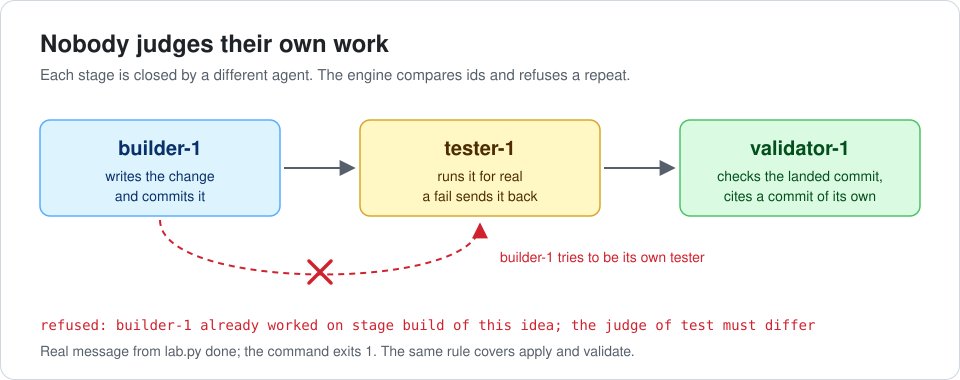

# foureyes

**English** · [Русский](README.ru.md)

[](https://github.com/dmitrykarpushkin/foureyes/actions/workflows/ci.yml)
[](LICENSE)

**A referee for coding agents: the agent that built a change is never the one that tests or approves it.**

For people who let several Claude Code or Codex agents work on their repos and want "done" to mean that someone
else checked it. Named after the four-eyes principle from banking and audit: nobody approves their own transaction.



## Why

An agent saying "done" is not evidence. Agents report tests they never ran, approve their own diff and drift outside the
task. Writing "please verify your work" into a prompt does not fix that, because a prompt is a request. foureyes moves the
rules that must always hold into a small engine that refuses a bad step.

- **"Done" is checked by someone else.** Work moves through triage, build, test, apply and validate. If the same agent
  tries to close two stages it must not, the command exits 1 and the step is not recorded.
- **Evidence is a commit, not a sentence.** The apply and validate stages must cite real commits on main that are newer
  than the task and differ from each other.
- **Your yes is bound to what you approved.** An approval stores a hash of the task text. Edit the task afterwards and the
  approval no longer counts.
- **Text an agent reads stays data.** Task descriptions are handed to agents inside a marker with a fresh random nonce, so a
  forged "end of data" line inside the text does not close it.
- **Small enough to read in one sitting.** About 500 lines of Python plus PyYAML, no model calls, 61 tests. Any agent tool
  that can run a shell command can use it.

## See it refuse

From the real output of `sh examples/walkthrough.sh`, which walks one task through the whole chain in a throwaway git
repo (trimmed; the task id is shown as `ID`; full output in [docs/walkthrough.md](docs/walkthrough.md)):

```console
$ lab.py done ID --agent scout-1 --verdict go --value 3 --cost-pct 0.5
refused: scout-1 is the submitter of this idea; the judge must differ
(exit 1)

$ lab.py done ID --agent builder-1 --verdict ok --note 'looks good to me'
refused: builder-1 already worked on stage build of this idea; the judge of test must differ
(exit 1)

$ lab.py done ID --agent applier-1 --verdict ok --evidence b610912
refused: --evidence is older than the idea (committed before submitted_at); it must be a new commit
(exit 1)

$ lab.py done ID --agent validator-1 --verdict ok --evidence 523cf1d
refused: validate evidence is the same commit as the apply evidence; they must differ
(exit 1)
```

In order: the submitter tries to triage its own task, the builder tries to test itself, the applier brings an old
commit, the validator reuses the apply commit. The same script then edits a stored file by hand to make the builder its own tester, and the separate check catches it:
`event 4 (test) is by builder-1, who also worked on a stage it must differ from`.

## How it compares

foureyes does not write specs or run agents. It sits between agents you already run and checks who signs off on what.
The big tools are far more mature; foureyes works best on top of them.

| Tool | Great at | What foureyes adds | Pick it when |
|---|---|---|---|
| [Spec Kit](https://github.com/github/spec-kit), [OpenSpec](https://github.com/Fission-AI/OpenSpec) | Writing specs, plans and task lists with your agent; OpenSpec validates document structure | Refusal in code when the author judges its own work or cites no real commit | You need help writing the spec; foureyes can use either as the depth for a bigger task |
| [BMAD-METHOD](https://github.com/bmad-code-org/BMAD-METHOD), [superpowers](https://github.com/obra/superpowers) | A full process for agents: roles, planning, TDD, review steps in skill text | A durable queue across sessions with an audit trail; reviewer independence is enforced, not asked for | You work inside one session and want zero setup |
| [CrewAI](https://github.com/crewAIInc/crewAI), [LangGraph](https://github.com/langchain-ai/langgraph), [AutoGen](https://github.com/microsoft/autogen) | Actually running agents: graphs, state, memory, tools | A referee that calls no model, with git commits as evidence | You need a runtime for agents; foureyes needs an orchestrator outside it |

## Quick start

Unix (macOS, Linux), Python 3 with PyYAML, git. Tested on Python 3.13.

```bash
git clone https://github.com/dmitrykarpushkin/foureyes && cd foureyes
pip install -r requirements.txt
sh examples/walkthrough.sh        # one task through the whole chain, four refusals included
```

`python3 -m unittest discover -s tests` runs the 61 tests. `bin/foureyes` is a short name for `python3 lab/lab.py`.

## How it works

- Each task (the code calls it an idea) is one YAML file. Every step is appended to it; nothing earlier is rewritten.
- The stages and the rule "who may not judge whom" are data in `lab/chains.yaml`; `lab.py done` enforces them.
- A separate check re-reads the stored files, so a hand edit that breaks the rules is caught afterwards.
- Your orchestrator asks `lab.py next` for open work, starts a fresh agent per stage with `lab.py brief ID`, and that
  agent closes its stage with `lab.py done ID --agent ITS_ID`.
- The written process (task sizes, plans as checkable criteria, what "done" means) is in [docs/SPEC.md](docs/SPEC.md).

More: [how it works](docs/how-it-works.md) · [the spec](docs/SPEC.md) · [full walkthrough](docs/walkthrough.md) ·
[evals from agent logs](lab/evals/README.md)

## Status and limits

A personal research project, used by one person to run their own agents. Said plainly:

- **Agent ids are labels.** The engine compares the names passed in `--agent`; it cannot prove two names are two fresh
  agents. Starting a fresh agent per stage is the orchestrator's job.
- **Not measured:** whether separating author and judge lowers the defect rate compared with self-review, and how often
  validators miss a problem.
- **Anecdotal, from the private project this came from:** the engine held 212 tasks; 145 were dropped (141 at triage) and
  36 went through all seven stages. All were run by agents of one setup, so this shows the chain works mechanically, not
  that the verdicts were right. It cannot be reproduced from this repo.
- An approval checks the shape of the reference, not who wrote it; the prompt-injection envelope is a mitigation with no
  measured success rate.

## Where it came from

Extracted on 2026-10-26 from my private monorepo, where it ran on my own projects. That repo has 1001 commits from
2026-09-28 to 2026-10-26; 105 of them touch the engine and the spec. Most were made by agents working under these checks.
The private history mentions other projects and internal ids, so it is not published; what changed when is in
[CHANGELOG.md](CHANGELOG.md).

## Part of a set

- [stopline](https://github.com/dmitrykarpushkin/stopline): git and Claude Code hooks that block a push while tests or
  checks are red.
- [needsyou](https://github.com/dmitrykarpushkin/needsyou): a dashboard that shows only what needs a person; it can read
  the board file foureyes writes. [Live demo](https://dmitrykarpushkin.github.io/needsyou/).

---

Working in this repo with an AI agent? Its rules are in [AGENTS.md](AGENTS.md).

License: MIT · Author: [Dmitry Karpushkin](https://github.com/dmitrykarpushkin)
