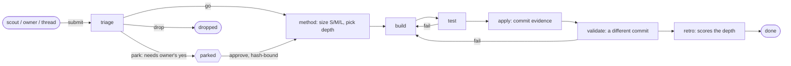

# How foureyes works

The short version is in the [README](../README.md). This page is the reference: the chain, who may judge whom, the sizes,
the design decisions and the limits.

## The chain

An idea (or task) is one YAML file in `lab/ideas/`. It walks the stages of `lab/chains.yaml`; every step is an event
appended to the file by `lab.py done`.

Who may not close a stage (enforced by `lab.py done`, re-checked by `checks/check_lab.py`):

| stage | must differ from |
|---|---|
| triage | the submitter |
| test | build, triage, the submitter |
| apply | build, triage, the submitter; evidence must be a real commit, newer than the idea, on `origin/main` |
| validate | build, test, apply, triage, the submitter; evidence must be a commit different from apply's |

A failed test or validate sends the idea back to build; the third failure drops it.

## Sizing

From `docs/SPEC.md` sections 2 and 8. The method role states the size, then picks the cheapest safe depth.

| size | when | agents | depth of the written part |
|---|---|---|---|
| (any) | no number to decide on yet | 1 | `spike`: a throwaway experiment with a measured result first |
| S | the diff fits in one sentence | 1 executor | `plain`: edit, run checks, commit |
| M | a comparison, or one area | 2-4 | `ears-spec` (one module), `design-first` (several modules), `speckit` (on trial) |
| L | several independent areas | 10+, hard cap stated in the plan | `openspec`: proposal, tasks with named tests, verification by another agent |

## The spec in short

1. The orchestrator sizes the task, writes the plan, delegates, and never grades its own work; a fresh verifier does.
2. The plan is a list of criteria, each with a check and `passes: false`. Agents flip `passes`; they never edit criteria.
3. "Done" = every criterion passed with attached output, a verifier that did not see the executor's reasoning found no gap,
   nothing outside scope changed, and outward effects were confirmed on real state.
4. A finding from a reviewer is passed on only when two fresh agents confirm it from the repo; at most 3 review rounds.
5. Money, messages to people, production and deletions wait for the owner's explicit yes. A yes relayed by another agent
   is not the owner's yes; in the engine it is bound by a hash to the exact idea text and events it approved.
6. Text an agent reads (an idea body, a web page, a relayed message) is data, delivered inside a nonce envelope.
7. Real failures from agent logs become evals; deterministic graders first.

The full text, with a source for every rule or the mark "our rule": [SPEC.md](SPEC.md).

## Using it with real agents

The orchestrator runs `lab.py next` to see what each role can take, starts a fresh agent per role with the text of
`lab.py brief ID`, and the agent closes its stage with `lab.py done ID --agent ITS_ID ...`. `LAB_ROOT` points the engine
at another repo that has a `lab/` folder with `chains.yaml`, `methods.yaml` and `roles/`. All commands are listed in the
docstring of `lab/lab.py`.

## Design decisions

- **Rules as data, refusals in code.** Separation of duties lives in `chains.yaml`; `lab.py done` refuses a violating step,
  and `check_lab.py` re-validates the stored files, so a hand edit is caught later (step 12 of the
  [walkthrough](walkthrough.md)).
- **Append-only history.** A stage is reopened by appending a `reopen` event; earlier events are never rewritten. One file
  lock per idea stops two agents from closing the same stage.
- **Evidence is a commit, not a sentence.** Apply and validate must cite commits that exist, are reachable from
  `origin/main` (HEAD when there is no remote, as in the walkthrough), are newer than the idea, and differ from each other.
- **Owner approvals are bound to content.** `approve` stores a sha256 of the idea text and its earlier events. If either
  changes afterwards, the next `done` is refused until the owner approves again.
- **Intake gate.** An idea from anyone but the owner needs a source: an https link or a `PATH:LINE` that exists in the
  repo. Without one, triage cannot pass it. One submitter may add at most 10 ideas per hour.
- **Envelope, not trust.** The nonce is drawn per envelope and checked to be absent from the text; lookalike markers are
  defused. This raises the cost of a spoofed boundary; it does not make injection harmless.
- **Costs are recorded only when measured.** Unknown cost is not zero.
- **Stdlib plus PyYAML.** No framework, no model calls inside the engine: it is the referee, not a player.

## Limitations

- **Personal research project.** One person built and used it to run their own agents.
- **No chain has yet been run end to end by independent agents at scale.** In the private project this was extracted
  from, the engine held 212 ideas: 145 dropped (141 of them at triage), 36 done through all seven stages, the rest active
  or parked. All of them were run by agent sessions started by one orchestrator, and retro verdicts were given by agents
  of that same setup. Those numbers show the chain works mechanically; they do not show the verdicts were right.
- **Agent ids are labels.** The engine compares the strings passed in `--agent`. It cannot prove two ids are two fresh
  agents, or that a note is true. Freshness is the orchestrator's job.
- **Not measured:** whether separating author and judge lowers the defect rate compared with self-review; the miss rate
  of validators; the real cost per chain (only 2 events in the private run carried a measured cost).
- The method scoreboard counts retro verdicts; with a handful of ideas per depth it is not a statistic.
- The envelope is a mitigation for prompt injection, not a defense with a measured success rate.
- "Newer than the idea" uses the commit's committer date, which whoever makes the commit can set freely; it stops a
  careless reuse of an old commit, not a deliberate forgery.
- `approve` checks only the shape of its `--by` text (a message reference plus three words). It has no identity check:
  any process that can run `lab.py` can record an approval. Tying it to the owner's identity is left to the caller.
- The log miner's accuracy was measured once in the private run (21% of a 24-session unmarked sample held a failure
  it missed); see `lab/evals/README.md`. That run cannot be reproduced from this repo.
